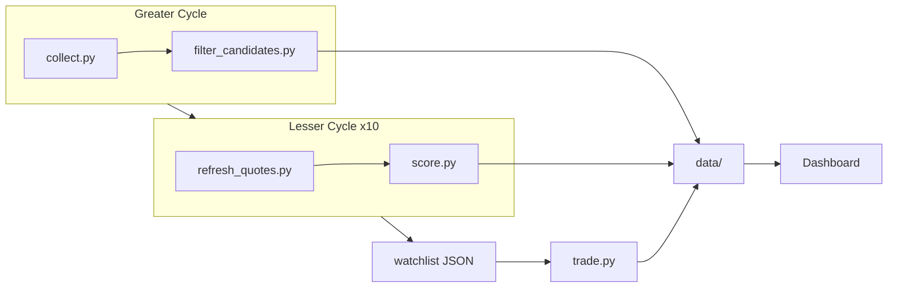
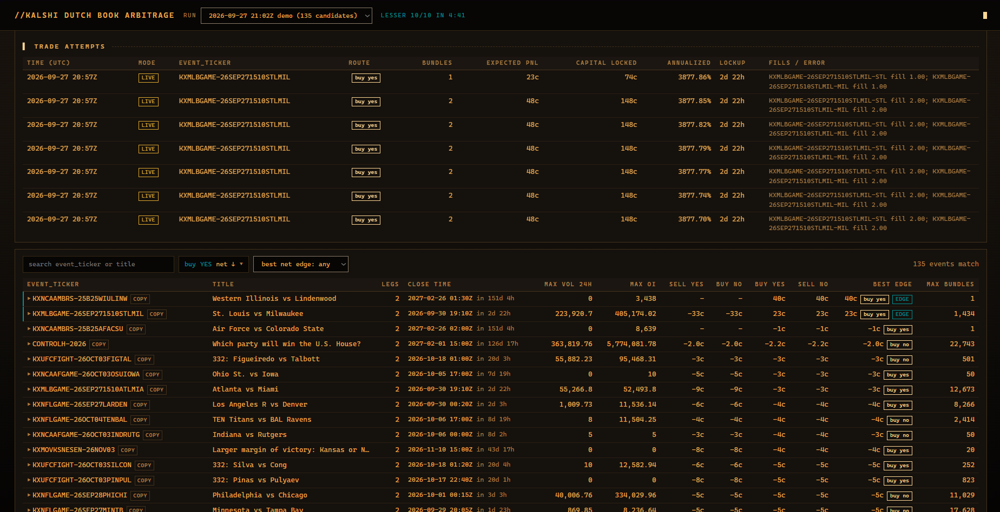

# Kalshi Dutch Book Arbitrage

A scanner and execution engine for Dutch-book (basket) mispricings on [Kalshi](https://kalshi.com) events that are flagged mutually exclusive. It walks every open event, keeps the ladders that are actually tradeable, ranks a short watchlist, and can send a balanced basket when the after-fee edge clears a return gate.

Mutually exclusive means at most one market in the event can settle YES. A tournament winner, a game winner, a "which party" market: exactly one contract pays $1.00, so the legs' prices have a known relationship to 100 cents. When the top of the book violates that relationship by more than fees, the basket is a Dutch book. This project finds those baskets, shows why each name survived the filter, and (with dry mode off) trades them.


## The idea

Four full-bundle routes follow from "at most one leg settles YES." Every edge the dashboard and the trader show is **net of estimated taker fees**. Gross is never the figure that fires an order.

| Route | Action | Gross (cents / 1 bundle) | Size bottleneck |
| --- | --- | --- | --- |
| Sell YES | sell YES at `yes_bid` on every leg | Σ yes_bid − 100 | min yes_bid_size |
| Buy NO | buy NO at `no_ask` on every leg | (N−1)×100 − Σ no_ask | min no_ask_size |
| Buy YES | buy YES at `yes_ask` on every leg | 100 − Σ yes_ask | min yes_ask_size |
| Sell NO | sell NO at `no_bid` on every leg | Σ no_bid − (N−1)×100 | min no_bid_size |

A route is priced only when every leg is hittable: price strictly between 0 and 100 cents, and resting size greater than 0. `0` and `100` are empty-book sentinels. **NO prices are never inferred from YES.** A missing field stays null, and that route is skipped.

The watchlist score is the busiest leg's 24-hour volume, `max(volume_24h_contracts)`. A missing or negative volume on any leg keeps the event out of the ranking. Best edge and best route are labels beside that rank. The trader still sends a basket only when the after-fee edge clears its return gate.

## Architecture

The dashboard runs the pipeline. One Greater Cycle builds the candidate universe. Ten Lesser Cycles re-quote that universe and publish a watchlist. Then Greater runs again. The trader is not a cycle step: it is a long-running process that subscribes to Kalshi's ticker WebSocket and prices the current watchlist from the live book.



`collect.py` pages through every open event with nested markets and writes a gzipped snapshot. `filter_candidates.py` applies the gates (mutually exclusive, market count, tradeable, at least one executable route, liquidity floor, time to close) and never calls the API. `refresh_quotes.py` re-quotes the survivors. `score.py` writes the top-N watchlist. `trade.py` holds positions to settlement, sends clips as one immediate-or-cancel batch, and writes a status file the dashboard displays. The pipeline client is GET-only. Writes happen only in `trade.py`, and `TRADER_DRY_MODE` defaults on.

## Screenshots

The watchlist is the top of the scored Lesser Cycle. Under it, the trader quotes each name from the live book and shows annualized return from now until the earliest leg close. Eligibility is a display of the same gates the trader uses before it will send a clip.


Trade attempts are the last fills the trader recorded: route, bundles, expected P&L, capital locked, annualized return, and time until the position can settle. The table below is the full candidate universe for the selected run, with per-leg bids and asks.



## Engineering highlights

- **Fixed point, not floats.** Kalshi prices and sizes arrive as decimal strings (`"0.4200"`, `"13.00"`). Everything is parsed with `Decimal`. Downstream JSON keeps prices as cent strings so a later reader does not reintroduce binary float drift. The dashboard computes edges in Python and sends them to the browser as strings for the same reason.
- **NO is never inferred.** Complement sizes are used only where the nested snapshot omits a NO *size*. Prices always come from the book fields Kalshi actually sent.
- **Signed requests.** REST and the ticker WebSocket use Kalshi's RSA-PSS headers: key id, millisecond timestamp, and a signature over `timestamp + method + path`, with the query string stripped and the `/trade-api/v2` prefix included.
- **Crash-safe orders.** Before any POST the trader writes an in-flight reservation (event, route, per-leg counts, prices, client order ids). On restart those ids are resolved before anything new is sent, and a POST is never retried with new ids.
- **Bounded risk by construction.** Dry mode is the default and never POSTs. Live mode sends one IOC batch. Filled capital counts against a per-event cap until Kalshi shows the event flat. There is no account-wide portfolio cap; the per-event cap is the diversification limit. Partial fills are not unwound; the trader only completes the short legs when the sunk prices plus the current book still leave a non-negative after-fee net.
- **The research path cannot trade.** `filter_candidates.py` never imports the client, the order module, or the WebSocket helper. Pointing the pipeline at production is still a read of public market data.

## Quick start

Requires Python 3.11 or newer. Each half has its own virtualenv.

**Core** (collector, filter, scorer, trader). From `Core`:

```powershell
python -m venv .venv
.\.venv\Scripts\python.exe -m pip install -r requirements.txt
Copy-Item .env.example .env
.\.venv\Scripts\python.exe check_auth.py
```

`.env` holds paths to credential files, never the keys themselves. Keep the key files outside this directory. Full gate list, cycle semantics, and the trader's fire rules are in [Core/README.md](Core/README.md).

**Dashboard.** From `Dashboard`:

```powershell
python -m venv .venv
.\.venv\Scripts\python.exe -m pip install -r requirements.txt
.\.venv\Scripts\python.exe serve.py
```

Then open the URL it prints, [http://127.0.0.1:8787/](http://127.0.0.1:8787/). On startup it runs a Greater Cycle, then Lesser Cycles, and supervises `Core/trade.py`. Pass `--no-cycle` or `--no-trader` to run it as a viewer. Panel-by-panel behavior is in [Dashboard/README.md](Dashboard/README.md).

## Repository layout

```
Core/            pipeline and trader (collect, filter, refresh, score, trade)
Dashboard/       local FastAPI dashboard over the files Core writes
ProjectMedia/    screenshots used in this README
```

`data/` (raw snapshots, candidates, watchlists, trader status) is gitignored. So is `.env`.

## Disclaimer

This is a research project, not financial advice and not a solicitation to trade. Demo order books are synthetic, so liquidity gates and edge figures from the demo environment are not meaningful. Live trading can lose money, including on partial fills that this system holds to settlement rather than unwinding. Read the code before you point it at production keys or turn dry mode off.
